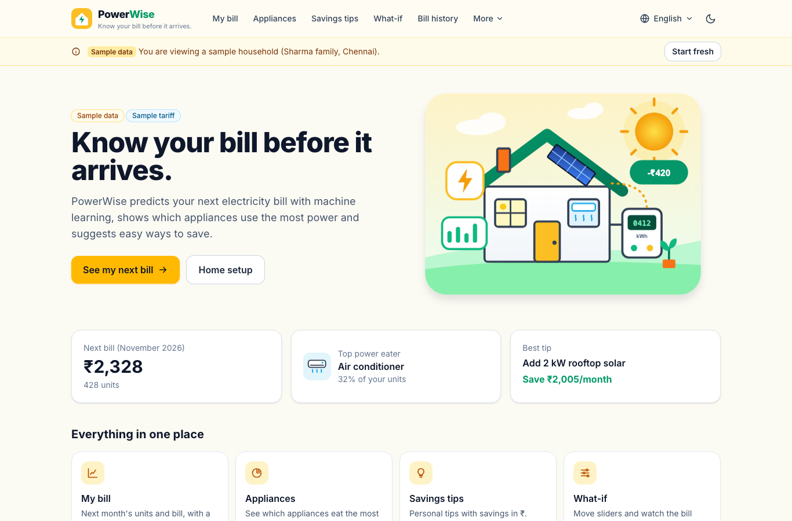
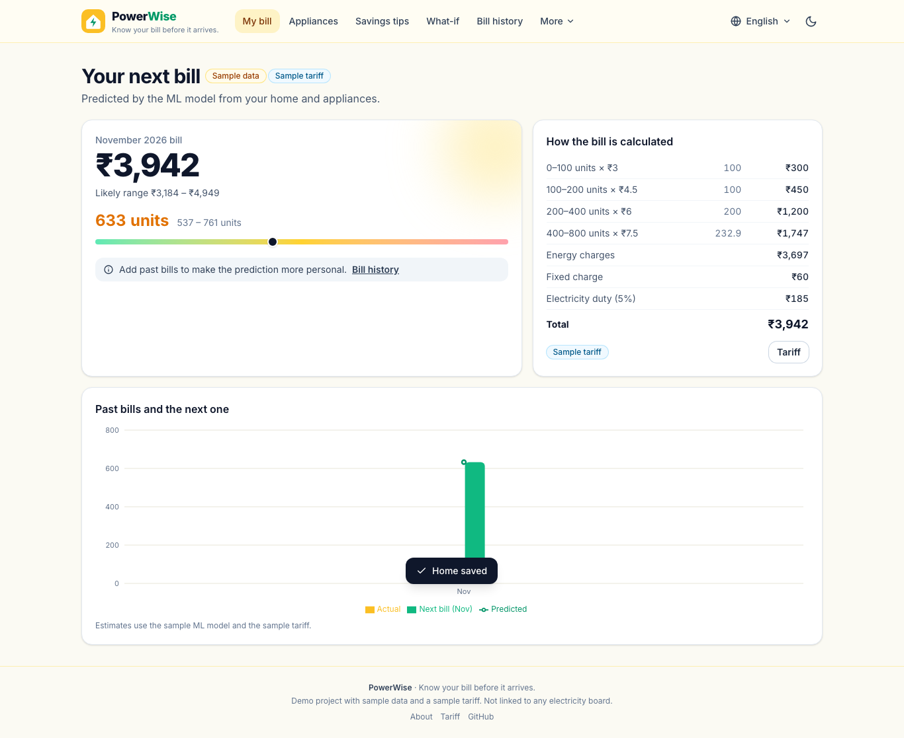
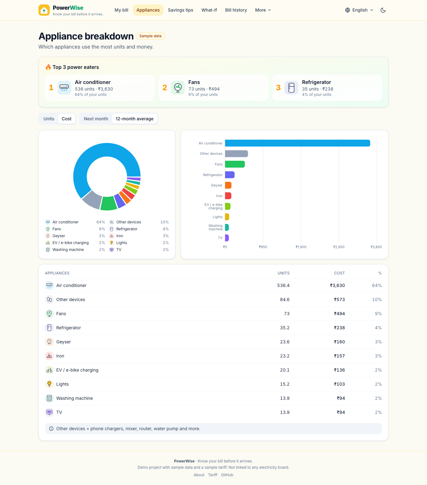
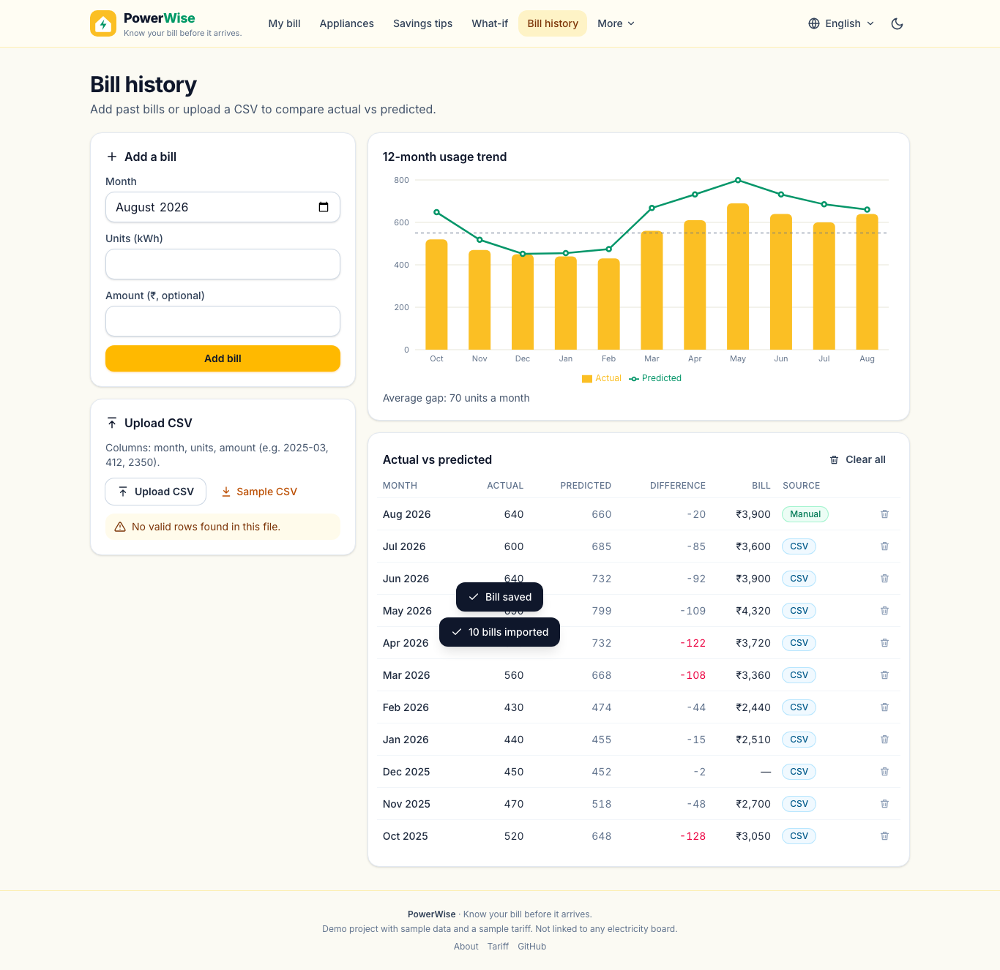
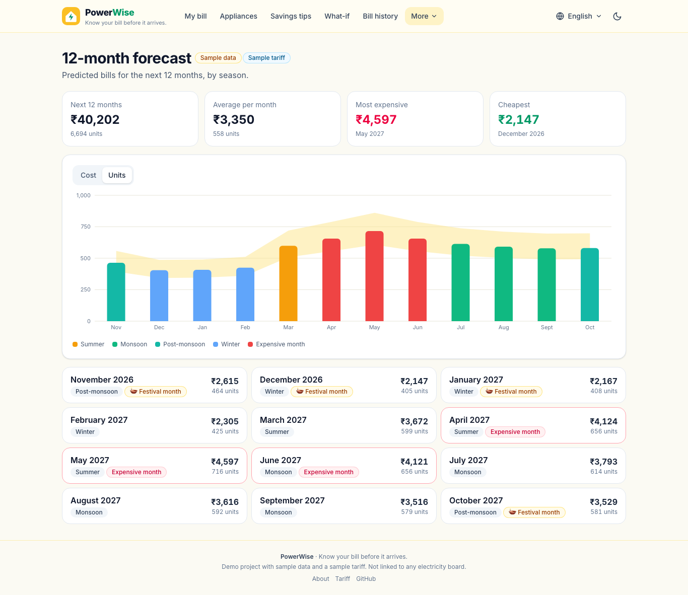
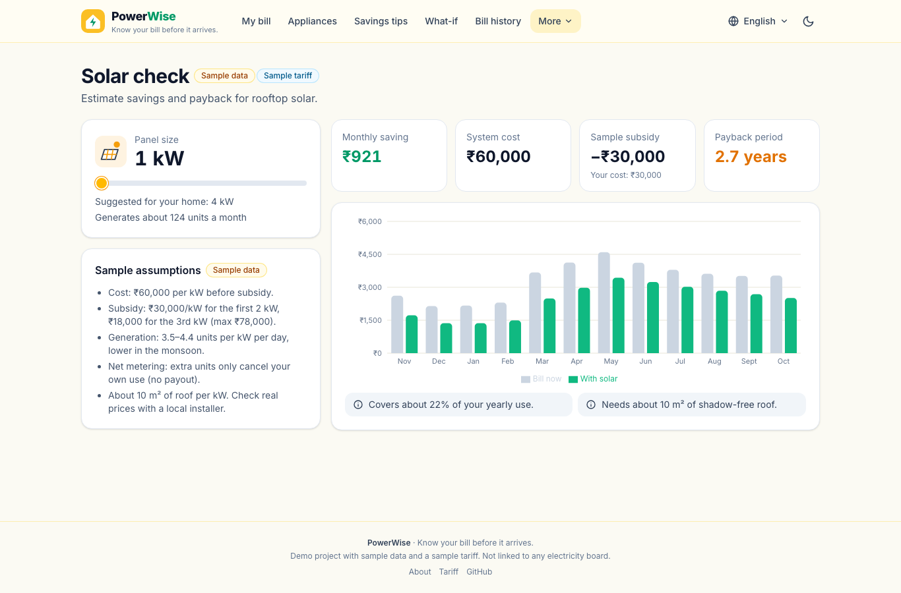
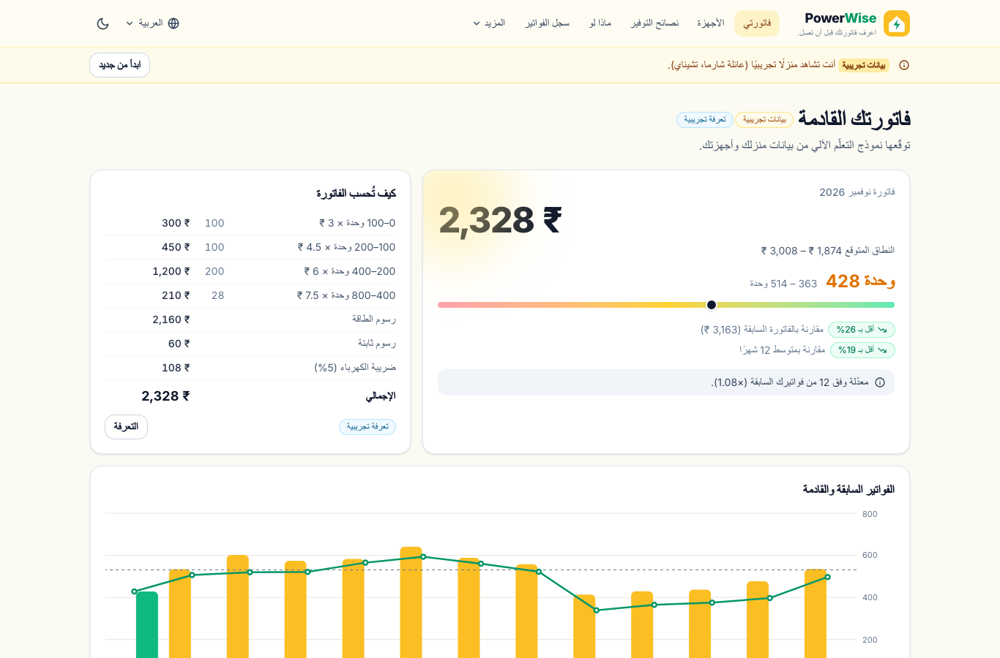

# PowerWise ⚡

**Know your bill before it arrives.**

PowerWise is a demo **smart electricity bill predictor** for Indian homes. You describe your home and appliances, and a machine-learning model forecasts next month's units (kWh) and bill. It also shows which appliances use the most power, suggests personal ways to save money (in ₹), and lets you try "what-if" changes with sliders.

> ⚠️ **Demo project: sample data and a sample tariff only.**
> Every household, bill and rate in PowerWise is synthetic. It is not linked to any electricity board, account or API. The default slab tariff is clearly labelled as **sample rates** and you can edit it to match your state.

## 🌐 Live demo

- **Live site:** _coming soon_
- **Source:** https://github.com/DIVYAPRIYADHARSHINI-GIT/powerwise

## ✨ Features

| # | Feature | What it does |
|---|---------|--------------|
| 1 | **Home setup** | A 3-step form: home details (city/climate, 1/2/3 BHK, members, work-from-home days), then 10 appliances with icons (count + hours per day, AC set-point, fridge star rating), then rooftop solar and a review. |
| 2 | **Bill prediction** | Predicted units and bill for next month with a likely range, a slab-by-slab bill breakdown, and a comparison with your last bill, your 12-month average and a past-bills chart. |
| 3 | **Appliance breakdown** | Pie and bar charts by units or cost (next month or 12-month average), a table, and a **"Top 3 power eaters"** card. |
| 4 | **Savings tips** | Personal tips with estimated savings in ₹/month (e.g. "Set the AC to 26°C instead of 22°C", "Use the geyser 15 minutes less each day"), sorted by saving. Tick the ones you will try, set a monthly savings goal and get a **celebration animation** when you reach it. |
| 5 | **What-if simulator** | Sliders for each appliance's hours and the AC temperature. The new bill updates instantly (the model also runs in the browser) and is confirmed by the `/api/predict` route. Save the change to your home with one click. |
| 6 | **Bill history** | Add past bills by hand or upload a CSV (flexible month formats such as `2025-03`, `Mar 2025`, `03/2025`). See a 12-month trend chart and actual vs predicted per month. Past bills also fine-tune future predictions for your home. |
| 7 | **12-month forecast** | Bills for the next 12 months coloured by season (summer, monsoon, post-monsoon, winter), with festival months marked and the 3 most expensive months highlighted. |
| 8 | **Solar check** | Monthly saving, system cost, sample subsidy, payback period, roof area and coverage for a chosen panel size, with a suggested size for your home. All assumptions are listed and labelled as samples. |
| 9 | **Reports** | Download a monthly **PowerWise report PDF** (English) and your **bill history CSV** (UTF-8, opens in Excel). |
| 10 | **17 languages** | English, தமிழ், हिन्दी, తెలుగు, ಕನ್ನಡ, മലയാളം, मराठी, বাংলা, ગુજરાતી, ਪੰਜਾਬੀ, ଓଡ଼ିଆ, اردو (RTL), Español, Français, العربية (RTL), 简体中文 and 日本語. The searchable language switcher in the nav bar remembers your choice. Each script uses a matching Noto font, and ₹ amounts follow each locale (₹2,328 · 2.328 ₹ · 2 328 ₹). |
| 11 | **Sample household** | The first visit loads a sample home (Sharma family, Chennai) with 12 months of bills. **Start fresh** clears it. |

**Design:** an energy-themed yellow/green palette, with "PowerWise" and the tagline in the nav bar. The app is mobile-first and responsive, with light/dark mode, loading skeletons and illustrated empty states. "Sample data" and "Sample tariff" labels appear on every relevant page. All illustrations (the hero home with a smart meter and solar roof, the 12 appliance icons, empty states, 404, the trophy celebration) are custom SVGs stored in the repo and served with `next/image`. No third-party images are used.

## 🛠 Tech stack

- **Next.js 16** (App Router, TypeScript) + **React 19**
- **Tailwind CSS 4**
- **Recharts** for all charts
- **API routes**: `/api/analyze`, `/api/predict`, `/api/bill`, `/api/solar`, `/api/report/pdf`, `/api/report/csv`, `/api/model`
- **localStorage** for the household, bills, tariff and settings (no database)
- **Python 3 + scikit-learn + NumPy** (only to generate data and train the model; not used at runtime)
- A dependency-free PDF writer, CSV parser and i18n layer
- Deployed on **Vercel** (Hobby plan) as one project

## 🤖 How the ML model works

1. **Synthetic dataset** (`ml/train_model.py`, seed 42): **1,200 Indian households × 30 months** (Apr 2024 – Sep 2026) = **36,000 monthly bills**. Each home has a city and climate (hot / moderate / cool), 1–3 BHK, 1–8 members, work-from-home days, optional rooftop solar, and up to 10 appliances (AC, fridge, geyser, washing machine, TV, fans, lights, iron, induction, EV/e-bike charging) with typical hours per day.
   Monthly units come from engineering rules: typical wattage × hours × seasonal factors. The data includes **summer AC peaks**, **winter geyser use**, **festival months** (Pongal, Onam/Ganesh, Navratri/Diwali, Christmas), **higher use in work-from-home homes**, solar net-metering and fridge star ratings. Behaviour noise, a hidden 2024 heatwave, travel months and guests are added on top. The CSVs are saved in `ml/data/`.
2. **Model:** a scikit-learn **`HistGradientBoostingRegressor`** (400 trees, 24 leaves, monotonic constraints). For example, more AC hours never lowers the bill, and a warmer AC set-point or more solar never raises it. Features are the home, appliance loads, AC set-point, month, festival intensity and season-aware loads (hours × climate factor).
3. **Evaluation:** the data is split **by household**, so 240 test homes are never seen during training.

   | Model | MAE (units/month) | R² | Error % |
   |-------|------------------:|---:|--------:|
   | **Gradient Boosting (used)** | **39.4** | **0.93** | **13.2%** |
   | Linear regression | 39.6 | 0.93 | 13.1% |
   | Baseline: average of similar homes (same BHK + climate + month) | 132.0 | 0.28 | 37.1% |

   The likely range (−15% / +20%) is the 10th–90th percentile of actual ÷ predicted on the test homes. The About page in the app shows these numbers and the main bill drivers.
4. **Export without Python:** every tree is exported to `src/data/model.json` (≈340 KB), and a ~20-line TypeScript tree walker (`src/lib/model.ts`) runs it in the API routes and in the browser. 20 parity samples are checked against scikit-learn (difference < 0.00001 units).
5. **Personalisation:** if you add past bills, the median actual ÷ predicted ratio of your last 12 bills (shrunk towards 1 when you have few bills) scales your forecast.
6. **From units to ₹:** the editable **slab (telescopic) tariff** turns units into a bill. Slabs are entered per month and are doubled automatically for **bi-monthly** billing. Fixed charges and electricity duty are added. Appliance shares come from typical wattage × your hours, scaled so they add up to the model's prediction. Every tip is priced by running the model again with that change applied.

**Default sample tariff** (monthly, editable on the Tariff page): 0–100 units ₹3 · 101–200 ₹4.5 · 201–400 ₹6 · 401–800 ₹7.5 · above 800 ₹9 · fixed charge ₹60/month · duty 5%.

## 🚀 Setup

Requirements: **Node.js 22.18+** (Python 3 is only needed to retrain).

```bash
git clone https://github.com/DIVYAPRIYADHARSHINI-GIT/powerwise.git
cd powerwise
npm install
npm run dev          # http://localhost:3000
```

Production build and tests:

```bash
npm run build && npm start         # production server
npm run typecheck                  # TypeScript
npm test                           # 26 unit tests (tariff, CSV, model parity, analysis, 17-language key check)
# end-to-end (uses the locally installed Google Chrome, no extra packages):
npx next start -p 3400 &
BASE_URL=http://localhost:3400 node tests/e2e/smoke.mjs
```

The e2e suite runs **227 checks**. It covers the API routes, the sample household and Start fresh, the full flow (setup → prediction → appliance breakdown → tips + goal celebration → what-if → history with manual + CSV bills → forecast → solar → tariff → PDF/CSV reports), every page in all 17 languages on desktop, mobile and dark mode (RTL for Urdu/Arabic), locale ₹ formatting, the language search and persistence, overflow and freeze checks. It uses short timeouts and a global watchdog.

Retrain the model / regenerate the sample data (optional):

```bash
python3 -m venv .venv && source .venv/bin/activate
pip install -r ml/requirements.txt
python ml/train_model.py     # writes ml/data/*.csv and src/data/{model,metrics,physics,sample}.json
```

## 🌍 Adding a language

1. Copy `src/i18n/messages/en.ts` to `src/i18n/messages/<code>.ts` and translate it. The `Messages` type flags any missing key, and `npm test` checks that the `{placeholders}` match.
2. Add one entry to `LOCALES` in `src/i18n/config.ts` (native name, direction, number/date locale) and one line to `src/i18n/loaders.ts`.
3. For a new script, add a Noto font in `src/app/layout.tsx` and its variable to `--font-sans` in `globals.css`.

Each language is a separate code-split chunk, so only the chosen language is downloaded.

## 📁 Project structure

```
ml/                      train_model.py, requirements.txt, data/*.csv (sample data)
src/data/                model.json (exported trees), metrics.json, physics.json, sample.json
src/lib/                 model.ts (inference + analysis), tariff.ts, solar.ts, csv.ts, pdf.ts, store.ts, client.ts
src/i18n/                config.ts, loaders.ts, index.tsx, messages/<lang>.ts (17 files)
src/app/                 pages: / setup predict appliances tips what-if history forecast solar reports tariff about
src/app/api/             analyze predict bill solar model report/pdf report/csv
src/components/          NavBar (language switcher), Charts, Icons (appliance SVGs), Celebration, ui
public/images/           hero + empty-state + 404 SVG illustrations
tests/unit, tests/e2e    node:test unit tests, headless-Chrome e2e (CDP, no dependencies)
```

## 📸 Screenshots

| Home (sample household) | Bill prediction | Appliance breakdown |
|---|---|---|
|  |  |  |
| **What-if simulator** | **Bill history** | **12-month forecast** |
|  |  |  |
| **Solar check** | **Goal celebration** | **Arabic (RTL) · Telugu (mobile, dark)** |
|  |  |  |

## 📄 License

MIT. All data, households and tariffs are synthetic samples created for this demo.
